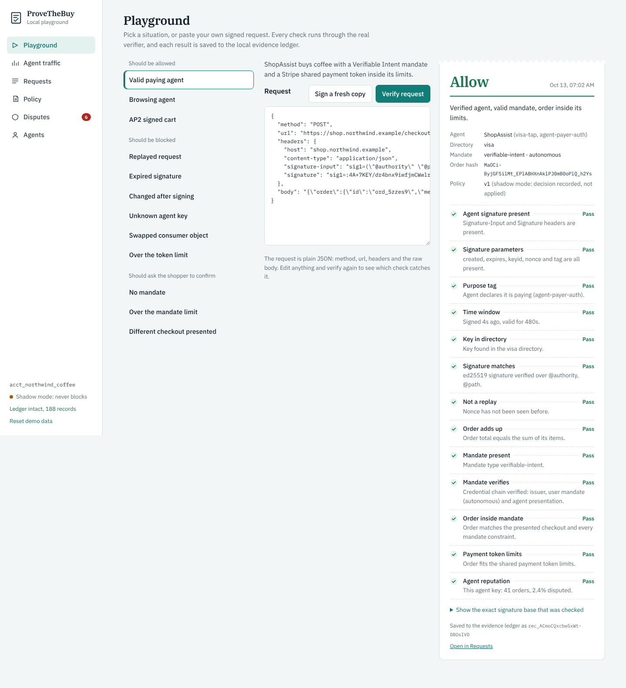
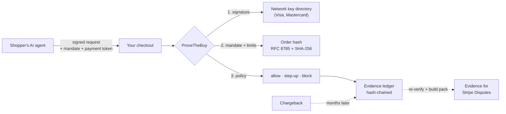

<div align="center">

<picture>
  <source media="(prefers-color-scheme: dark)" srcset="assets/logo-dark.svg">
  
</picture>

### Prove what the shopper's agent was allowed to buy.

Verify the agent. Bind the order. Win the dispute.

[](LICENSE)
[](package.json)
[](docs/protocols.md#rfc-9421)
[](docs/roadmap.md)

[Try it in 60 seconds](#try-it-in-60-seconds) ·
[Add it to a checkout](#add-it-to-your-checkout) ·
[How it works](#how-it-works) ·
[Docs](docs/)

</div>

<br>

AI agents now place real orders: ChatGPT, Claude, Perplexity, and shopping agents built on Visa's Trusted Agent Protocol and Mastercard Agent Pay. When one of those orders turns into a chargeback, the merchant usually has nothing to show except "a bot bought it".

**ProveTheBuy is the merchant-side layer that fixes that.** It sits in front of your checkout, and for every agent request it:

1. **Verifies the agent.** Checks the agent's HTTP message signature (RFC 9421, Web Bot Auth) against the card network's key directory, and rejects replays, expired signatures and edited requests.
2. **Binds the order.** Checks the shopper's signed mandate (Mastercard Verifiable Intent, AP2) and payment token limits, and confirms that this exact cart, amount and merchant are inside what the shopper allowed.
3. **Keeps the proof.** Writes a tamper-evident evidence record, and when a dispute arrives, re-verifies it and builds the evidence pack for you.

It runs in your own server, never sees card numbers, and starts in **shadow mode**: it records what it would decide without ever blocking a sale.

<br>

<p align="center">
  
</p>

## Try it in 60 seconds

You need [Node.js 18.17 or newer](https://nodejs.org). Nothing else: no database, no accounts, no API keys.

```bash
git clone https://github.com/provethebuy/provethebuy.git
cd provethebuy
npm install
npm run demo
```

Then open **http://localhost:4319**.

The playground loads a simulated day of agent traffic for a demo coffee shop and gives you six screens:

| Screen | What you can do |
| --- | --- |
| **Playground** | Pick a situation (valid agent, replay, tampered request, order over the mandate limit…), edit the signed request, and see every check the verifier ran. |
| **Agent traffic** | See which agents reached the store and what would have been decided. Drop in your own access log to count AI agents in it. |
| **Requests** | Inspect any request: each check, the raw headers, and its place in the hash-chained ledger. |
| **Policy** | Edit the YAML policy, dry-run it against everything recorded so far, then apply it. |
| **Disputes** | Open a chargeback and read the evidence pack, re-verified with the key snapshot from the day of the order. |
| **Agents** | Every agent key seen, with its order count and dispute rate. |

Everything runs on your machine. Press `Ctrl+C` to stop, or use **Reset demo data** in the sidebar to start over.

## Add it to your checkout

**1. Install**

```bash
npm install @provethebuy/verify
```

> The package is published with the first tagged release. Until then, install it from a clone of this repo with `npm install ./packages/verify`.

**2. Put it in front of your checkout route**

```js
import express from "express";
import { ProveTheBuy, KeyDirectory, KNOWN_DIRECTORIES, FileLedger } from "@provethebuy/verify";
import { createMiddleware } from "@provethebuy/verify/express";

const ptb = new ProveTheBuy({
  merchantId: "acct_your_shop",                       // as it appears in mandates and payment tokens
  keys: new KeyDirectory({ sources: [{ name: "visa", url: KNOWN_DIRECTORIES.visa }] }),
  policy: { mode: "shadow" },                         // record decisions, never block
});

const agents = createMiddleware(ptb, new FileLedger("acct_your_shop", "evidence.jsonl"));
const app = express();

// capture() must come before any body parser, so the bytes are kept exactly as signed.
app.post("/checkout", agents.capture(), agents.verify(), (req, res) => {
  const paymentIntent = chargeTheCustomer(req);       // your existing payment code
  agents.record(req, { paymentIntent });              // write the evidence record
  res.json({ ok: true });
});
```

**3. Read the decision**

Every request gets `req.provethebuy`:

```js
{
  decision: "allow",                // allow | step_up | block | not_agent
  reasons: ["Verified agent, valid mandate, order inside its limits."],
  enforced: false,                  // true only in enforce mode
  agent:   { keyid: "shopassist-k1", protocol: "visa-tap", tag: "agent-payer-auth" },
  mandate: { type: "verifiable-intent", mode: "autonomous", valid: true },
  checks:  [ /* every check, with pass / fail / warn / skip and a plain-English detail */ ]
}
```

Requests from people (no agent signature) come back as `not_agent` and pass straight through. When you're happy with what shadow mode shows, set `mode: "enforce"` and step-ups return `409`, blocks return `403`.

A complete runnable version is in [`examples/express-checkout`](examples/express-checkout): `npm run example` starts the shop, and `npm run agent` (in a second terminal) plays a shopping agent against it.

## How it works



For each request the verifier runs the checks in order and stops at the first one that settles the decision:

| Stage | Checks |
| --- | --- |
| **Signature** | headers present and readable, purpose tag, time window (8 minutes max), key in a trusted directory, signature matches, nonce never seen before |
| **Body objects** | Visa consumer-recognition and payment-container objects are bound to the same nonce and key |
| **Order** | the cart adds up, and it's addressed to your merchant id |
| **Mandate** | the credential chain verifies, and this order is inside its amount, merchant and item limits |
| **Payment token** | Stripe shared payment token limits: amount, currency, merchant, expiry |
| **Reputation** | this agent key's dispute rate at your store, from your own ledger |

The full picture, including the data model and the dispute flow, is in [docs/architecture.md](docs/architecture.md) and [docs/flows.md](docs/flows.md).

## What it supports

Agent commerce standards are still settling. This table says plainly how far each one is implemented.

| Standard | What ProveTheBuy checks | Status |
| --- | --- | --- |
| **RFC 9421** HTTP Message Signatures | Ed25519, RSA-PSS-SHA512, ECDSA P-256; passes the RFC's own Ed25519 test vector (B.2.6) | Stable |
| **Web Bot Auth** | `agent-browser-auth` and `agent-payer-auth` tags, key directories, nonce replay | Stable |
| **Visa Trusted Agent Protocol** | signature against `mcp.visa.com` JWKS; consumer-recognition and payment-container body objects | Beta. Body-object signing follows our reading of the spec until [visa/trusted-agent-protocol#23](https://github.com/visa/trusted-agent-protocol/issues/23) is answered |
| **Mastercard Agent Pay / Verifiable Intent** | 3-layer SD-JWT chain (issuer, user, agent), order binding through `transaction_id`, amount, merchant and item constraints | Preview |
| **AP2** (Agent Payments Protocol) | cart mandate (merchant and user signatures), intent mandate with an unattended-amount threshold | Preview. How user keys are trusted is not settled yet, so it's reported as a note |
| **Stripe shared payment tokens / ACP** | allowance limits: amount, currency, merchant, expiry | Limits only |

## Command line

The CLI ships with the same verifier.

```bash
# How many AI agents hit your store yesterday, and how many reached checkout?
npx provethebuy traffic-check /var/log/nginx/access.log

# Write a starter policy
npx provethebuy init

# Verify a saved request against a key directory
npx provethebuy verify request.json --jwks https://mcp.visa.com/.well-known/jwks --merchant acct_your_shop

# Check that an evidence ledger hasn't been edited
npx provethebuy ledger verify evidence.jsonl
```

From a clone, run them with `node packages/cli/dist/cli.js` after `npm run build`. Try `traffic-check packages/cli/samples/access.log` to see the output.

## Policy

Decisions come from one small YAML file. Start in shadow mode, watch, then enforce.

```yaml
mode: shadow            # shadow: record only. enforce: apply decisions.
fail: open              # if the verifier itself errors, let the order through

mandate:
  on_missing: step_up   # allow | step_up | block
  on_outside: step_up   # step_up | block

reputation:
  step_up_if_agent_dispute_rate_over: 0.02
  min_orders_for_reputation: 20
```

Every option is explained in [docs/policy.md](docs/policy.md).

## Security

- **No card data.** ProveTheBuy reads signatures, mandates and token limits. It never sees a card number, so it adds nothing to your PCI scope.
- **Fails open by default.** If the verifier errors, the order goes through and the error is recorded. Switch to `fail: closed` when you trust it.
- **Replay protection.** Nonces are remembered for the signature's lifetime. Use the Redis store when you run more than one server.
- **Evidence you can re-check.** Each record stores the raw signed request and a snapshot of the key, chained by hash. A dispute months later re-verifies against that snapshot, even after the agent rotated its key.

Read the threat model in [docs/security.md](docs/security.md). To report a vulnerability, see [SECURITY.md](SECURITY.md).

## Project layout

```
packages/verify        @provethebuy/verify: the verifier, ledger, evidence packs, Express middleware
packages/cli           @provethebuy/cli: traffic-check, init, keys, sign, verify, ledger verify
apps/playground        the local web app behind `npm run demo`
examples/              a runnable Express checkout and a script that plays an agent
test-vectors/          signed requests with expected decisions, for other-language ports
docs/                  architecture, flows, protocols, policy, security, roadmap
```

`npm test` builds everything and runs the unit tests, the CLI tests and all test vectors.

## Roadmap

- Python and Go verifiers that pass the same [test vectors](test-vectors/)
- ProveTheBuy Cloud: hosted ledger, dashboard, and automatic evidence submission to Stripe Disputes
- A Stripe App, so merchants can turn it on without code
- Full AP2 support once its signing rules settle

See [docs/roadmap.md](docs/roadmap.md) and [docs/cloud-screens.md](docs/cloud-screens.md) for the first cloud release.

## Contributing

Issues and pull requests are welcome, especially new test vectors from real agent traffic and ports to other languages. Start with [CONTRIBUTING.md](CONTRIBUTING.md).

## License

[Apache-2.0](LICENSE)
