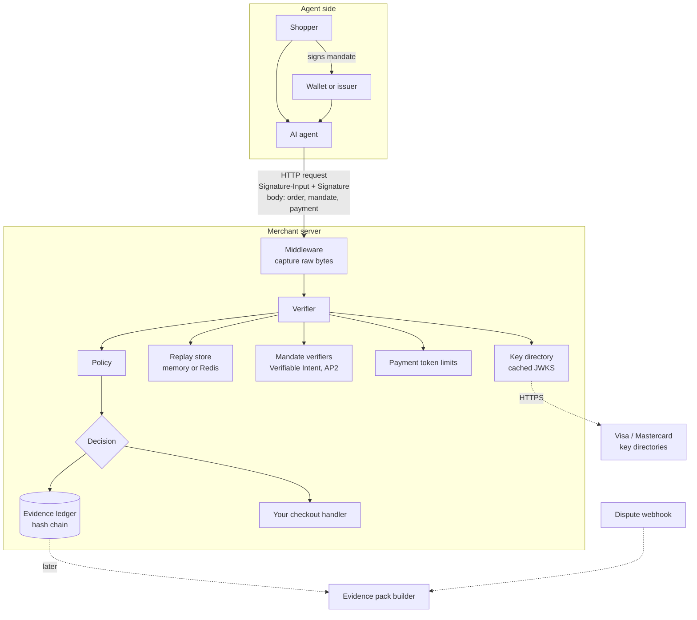

# Architecture

ProveTheBuy has one job at order time (decide whether an agent's order is provably authorised) and one job at dispute time (prove it). Everything runs inside the merchant's own server; the hosted cloud, when it arrives, only stores and automates.



## Components

| Component | Source | What it does |
| --- | --- | --- |
| Middleware | `packages/verify/src/express.ts` | Keeps the request body byte-for-byte as signed, rebuilds the public URL behind proxies, attaches `req.provethebuy`, and returns 403 / 409 only in enforce mode. |
| HTTP signatures | `src/httpsig.ts` | RFC 9421 parsing, signature base, and Ed25519 / RSA-PSS / ECDSA verification. No custom crypto: everything goes through Node's WebCrypto. |
| Key directory | `src/keys.ts` | Loads JWKS from URLs or inline, caches them, and records a SHA-256 snapshot of the exact key used, so the record can be re-verified after rotation. |
| Replay store | `src/replay.ts` | Remembers each nonce for the signature's lifetime. In memory for one server; Redis (`SET NX EX`) for several. |
| Mandate verifiers | `src/mandates/` | Mastercard Verifiable Intent (3-layer SD-JWT) and AP2 cart and intent mandates. Each returns its own checks and a constraint result. |
| Body objects | `src/bodyObjects.ts` | Visa TAP consumer-recognition and payment-container objects, bound to the header signature by nonce and key. |
| Payment limits | `src/payment.ts` | Stripe shared payment token / ACP allowance: amount, currency, merchant, expiry. |
| Order hash | `src/order.ts` | RFC 8785 canonical JSON, then SHA-256, base64url. The value that ties a mandate to one exact cart. |
| Policy | `src/policy.ts` | Turns checks into `allow`, `step_up` or `block`. Versioned by content hash, so every record says which policy decided it. |
| Ledger | `src/ledger.ts` | Append-only records, each hashing the previous one, with a Merkle root for anchoring. `FileLedger` writes JSON Lines. |
| Evidence | `src/evidence.ts` | Re-verifies a stored record against its key snapshot and writes the evidence pack for a given reason code. |
| Reputation | `src/reputation.ts` | Per-agent order, mismatch and dispute counts from the merchant's own ledger. |

## Data model

The ledger holds two record types, `verification` and `dispute`, in one chain.

```jsonc
{
  "type": "verification",
  "record_id": "rec_o4Vx8KrZkA0OGlwm2FaNYV",
  "merchant": "acct_northwind_coffee",
  "received_at": "2026-10-13T06:56:12.000Z",
  "request": { "method": "POST", "authority": "shop.northwind.example", "path": "/checkout", "raw_sha256": "…" },
  "agent": {
    "protocol": "visa-tap", "keyid": "shopassist-k1", "tag": "agent-payer-auth",
    "directory": "visa", "created": 1791874563, "keySnapshotSha256": "…"
  },
  "checks": [ { "name": "signature_valid", "status": "pass", "detail": "ed25519 signature verified over @authority, @path." } ],
  "mandate": { "type": "verifiable-intent", "mode": "autonomous", "valid": true, "constraintsOk": true },
  "order":   { "order_hash": "mLrSoxZ1…", "order_id": "ord_5u1lw8", "amount": 3850, "currency": "usd", "payment_intent": "pi_b4jc0pcf" },
  "policy_version": "v1",
  "decision": "allow",
  "enforced": false,
  "reasons": ["Verified agent, valid mandate, order inside its limits."],
  "artifacts": { "request": { /* raw signed request */ }, "key_jwk": { /* public key snapshot */ }, "context": { /* order, mandate, payment */ } },
  "prev_hash": "…",
  "hash": "…"
}
```

`hash` is SHA-256 over the canonical JSON of the record without `hash`, so editing any field, or removing a record, breaks every hash after it. `provethebuy ledger verify` and the playground's sidebar both check this.

## Where it runs

| Piece | Runs in | Notes |
| --- | --- | --- |
| Verifier, ledger, evidence | Your server | Node 18.17+. Signature checks are local once keys are cached, so they add a few milliseconds. |
| Key directories | Visa, Mastercard | Fetched over HTTPS and cached (default 10 minutes). |
| Cloud (planned) | Hosted | Receives ledger records asynchronously. It can never slow down or block a checkout. |
