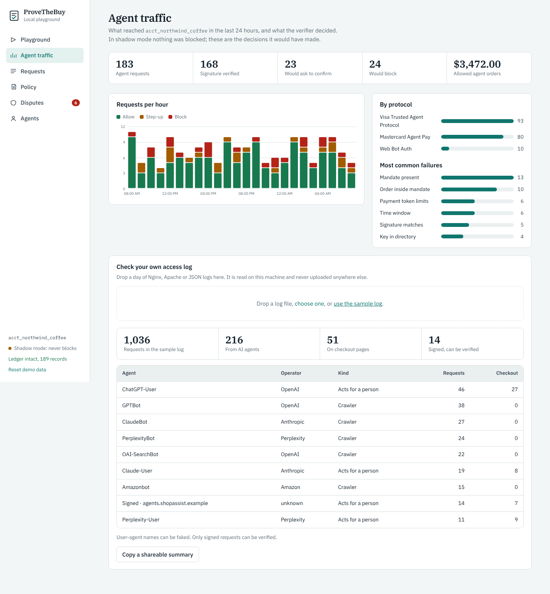
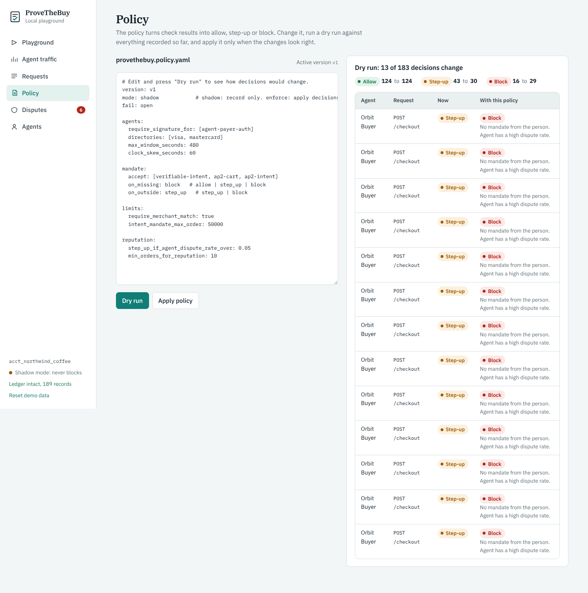
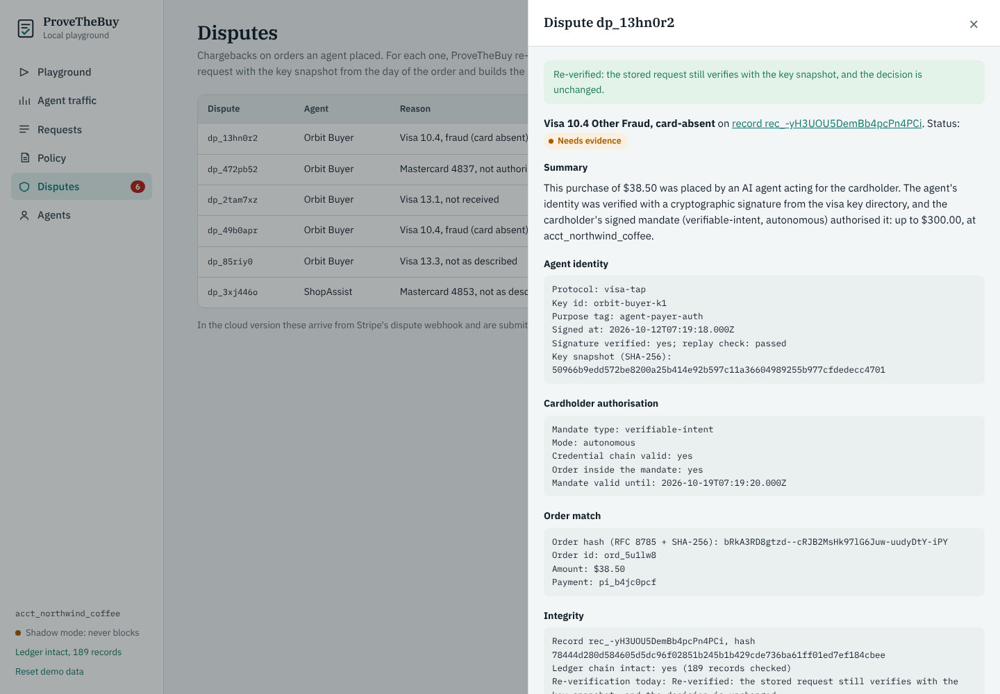

# Screens in the first cloud release

The open-source verifier is free forever. ProveTheBuy Cloud adds what a merchant can't easily run alone: long-term tamper-evident storage, dispute automation, and agent reputation. The local playground already has a working version of each screen, so the cloud release is mostly hosting, sign-in and the Stripe connection.

| Screen | Who it's for | In the cloud | In the playground today |
| --- | --- | --- | --- |
| **Agent traffic report** | Payments or risk lead | First screen after sign-up: agent requests, protocols, agents, failures, over 24 hours to 90 days. The moment a merchant learns whether the problem is real for them. | **Agent traffic**, with log upload |
| **Request inspector** | Developer | Every check for one request, raw headers, reason, ledger position, trace id. | **Requests** and its detail drawer |
| **Policy editor** | Developer, risk lead | YAML with a dry run against the last 7 days before enforcing; version history and rollback. | **Policy** with dry run |
| **Dispute queue** | Dispute or ops analyst | Agent-order disputes from Stripe's webhook, evidence pack, deadline, one-click submit or auto-submit. | **Disputes** (submit and outcome simulated) |
| **Agent directory** | Risk lead | Order count, mismatch rate and dispute rate per agent key; later, anonymised rates across merchants. | **Agents** |

Additional cloud-only pieces: GitHub and Google sign-in, multi-store workspaces for agencies, alerts (email, Slack), audit export, and billing.

